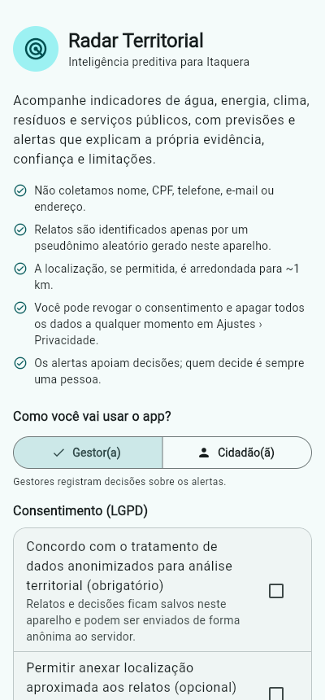
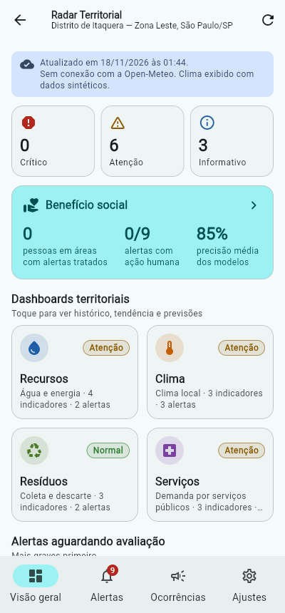
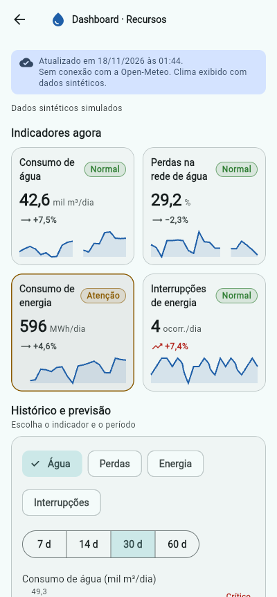
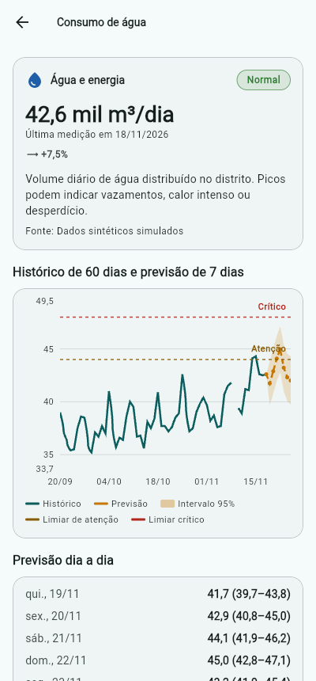
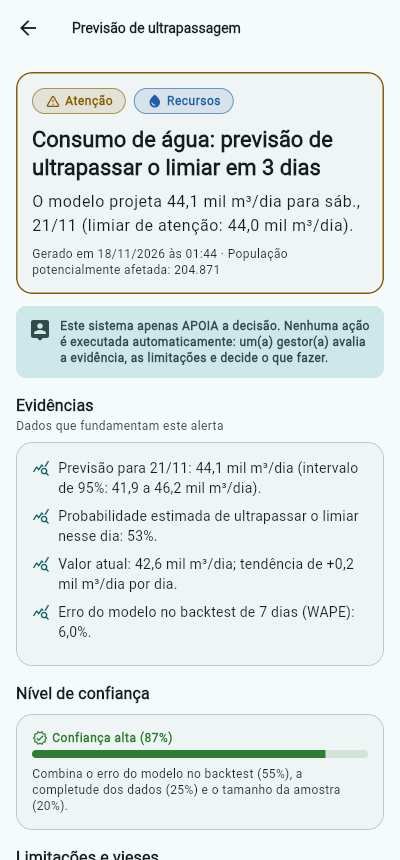
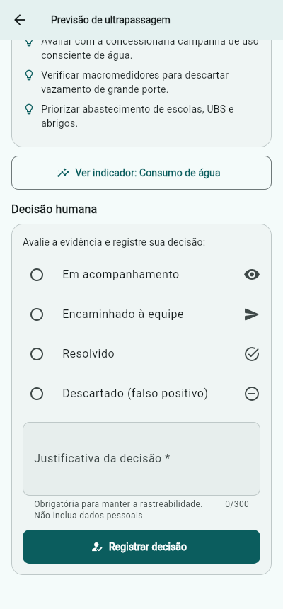
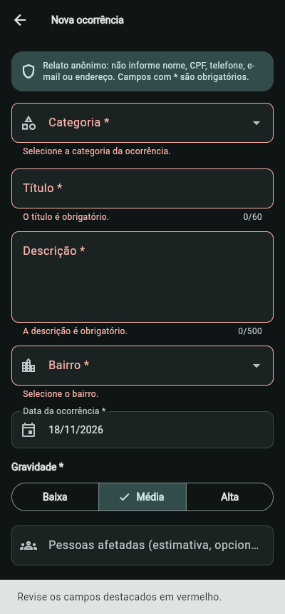
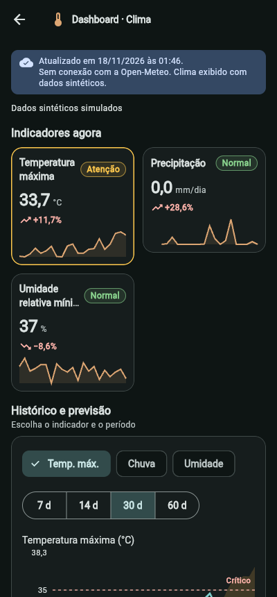

# Radar Territorial — Territory Predictive Insights

> **Global Solution 2026.2 · Cross-Platform Application Development · Tema CitizenTech**
>
> Aplicativo Flutter que funciona como **central de inteligência territorial**: gestores públicos e cidadãos acompanham indicadores, previsões e alertas do **Distrito de Itaquera (Zona Leste de São Paulo)**. Cada alerta vem com **evidência, nível de confiança e limitações**, e **a decisão final é sempre humana**.

## Integrantes

| Nome | RM |
|------|----|
| Thiago Ono Sakai | 563448 |
| Lukas Eiki | 561607 |
| Pedro Mitsuo | 561710 |

## Sumário

1. [Problema e público](#1-problema-e-público)
2. [Funcionalidades](#2-funcionalidades)
3. [Como executar](#3-como-executar)
4. [Arquitetura e estrutura de pastas](#4-arquitetura-e-estrutura-de-pastas)
5. [Decisões técnicas e bibliotecas](#5-decisões-técnicas-e-bibliotecas)
6. [Fontes de dados](#6-fontes-de-dados)
7. [Modelo preditivo, métricas e limitações](#7-modelo-preditivo-métricas-e-limitações)
8. [Privacidade, acessibilidade e impacto social](#8-privacidade-acessibilidade-e-impacto-social)
9. [Mapa dos critérios de avaliação](#9-mapa-dos-critérios-de-avaliação)
10. [Testes](#10-testes)
11. [Telas](#11-telas)

---

## 1. Problema e público

Itaquera tem ~205 mil habitantes, áreas de várzea sujeitas a alagamento, UBS sobrecarregadas e pontos crônicos de descarte irregular. Os problemas costumam ser percebidos **depois** de acontecerem: o calor já elevou o consumo de água, a fila da UBS já passou de uma hora.

O Radar Territorial antecipa esses problemas combinando dados públicos e sintéticos com um modelo estatístico interpretável, e entrega a informação em um formato que apoia — sem substituir — a decisão de quem gere o território.

| Público | O que faz no app |
|---|---|
| **Gestor(a) público(a)** | Acompanha dashboards, avalia alertas, registra decisões justificadas, ajusta limiares. |
| **Cidadão / cidadã** | Acompanha indicadores do bairro e registra ocorrências de forma anônima. |

## 2. Funcionalidades

- **4 dashboards territoriais**: Recursos (água e energia), Clima, Resíduos e Serviços. Cada um tem cards de KPI com sparkline e tendência, gráfico de histórico + previsão de 7 dias com faixa de 95% e linhas de limiar, gráfico de barras com médias semanais, seletor de período (7/14/30/60 dias) e alertas do domínio.
- **Detalhe do indicador**: previsão dia a dia com intervalo, métricas de backtest (WAPE, MAE, R², completude), condições em que a previsão **não** é confiável, limiares e alertas relacionados.
- **Alertas preditivos** de 5 tipos: limiar ultrapassado, previsão de ultrapassagem, anomalia estatística, tendência persistente e aumento de relatos cidadãos. Cada alerta exibe **evidências numéricas, confiança (0–100% + Alta/Média/Baixa), limitações e vieses, ações sugeridas** e um aviso fixo de que nada é executado automaticamente.
- **Decisão humana registrada**: o gestor escolhe *Em acompanhamento / Encaminhado / Resolvido / Descartado*, com **justificativa obrigatória** e confirmação. As decisões ficam salvas (trilha de auditoria) e podem ser reabertas.
- **Ocorrências cidadãs** com formulário validado, envio offline-first (fila de sincronização) e cruzamento com os indicadores (3+ relatos geram alerta).
- **Configuração de limiares** por indicador, com validação de faixa plausível e regra cruzada (crítico precisa ser pior que atenção).
- **Benefício social**: pessoas cobertas por alertas tratados, água potencialmente economizada, tempo de resposta, taxa de falsos positivos e precisão dos modelos.
- **Transparência algorítmica**: tela com método, regras, vieses e métricas de todos os modelos.
- **Privacidade (LGPD)**: consentimento explícito e versionado, pseudonimização, revogação e exclusão total de dados.
- **Acessibilidade**: tema claro/escuro, alto contraste, escala de fonte (soma-se à do sistema), redução de animações, rótulos para leitores de tela (inclusive descrição textual dos gráficos).
- **Modo offline**: dados ficam em cache; sem rede o app continua navegável e mostra a data dos dados salvos. Há um interruptor em *Ajustes › Demonstração* para simular a falta de conexão.

## 3. Como executar

Pré-requisito: **Flutter 3.50+** (Dart 3.12+). O projeto usa o pacote `material_ui`, para onde o Material foi movido no Flutter 3.50.

```bash
flutter pub get
```

```bash
flutter run
```

Para web (renderização sem depender de CDN):

```bash
flutter run -d chrome --no-web-resources-cdn
```

Testes e análise estática:

```bash
flutter analyze
```

```bash
flutter test
```

Não há chaves de API. O clima usa o CSV da estação A701 guardado em `lib/data/2026` (a mais próxima de Itaquera; o distrito não tem estação própria) e, se esse arquivo faltar, a página pública do INMET. A população do distrito vem da API do IBGE. Se uma fonte falhar, o app avisa e segue com o fallback.

## 4. Arquitetura e estrutura de pastas

Arquitetura em camadas, com dependências sempre apontando "para dentro" (UI → estado → domínio/dados):

```
UI (screens/widgets) ──► State (Providers) ──► Domain (analytics puros)
                               │
                               └──► Data (repositories ──► services/APIs + storage)
```

```
lib/
├── main.dart                     # bootstrap (locale pt_BR, storage)
├── app.dart                      # injeção de dependências, tema, rotas, acessibilidade
├── core/
│   ├── constants/territory.dart  # território + catálogo dos 13 indicadores
│   ├── routes/                   # rotas nomeadas + argumentos tipados + roteador
│   ├── theme/                    # tokens (cores, espaçamentos) e ThemeData
│   └── utils/                    # formatadores pt-BR, validadores, privacidade
├── data/
│   ├── models/                   # entidades imutáveis com toJson/fromJson
│   ├── services/                 # INMET (scraping), IBGE, API simulada, storage local
│   └── repositories/             # orquestram fontes + cache (offline-first)
├── domain/analytics/             # estatística, previsão, alertas, impacto social (Dart puro)
├── state/                        # ChangeNotifiers globais + ViewStatus
└── ui/
    ├── widgets/                  # componentes reutilizáveis da identidade visual
    └── screens/                  # onboarding, home, overview, dashboard, indicator,
                                  # alerts, occurrences, settings
test/                             # 37 testes: analytics, validadores, repositório, widgets
```

### Navegação

Rotas nomeadas em `core/routes/app_routes.dart`, resolvidas por `AppRouter.onGenerateRoute` com **argumentos tipados** (`DashboardArgs`, `IndicatorArgs`, `AlertArgs`, `OccurrenceFormArgs`, `ThresholdsArgs`...). Fluxo principal:

```
Consentimento → Home (abas) → Visão geral → Dashboard (domínio)
                                         → Indicador (id) → Alerta (id) → Decisão
                                                          → Nova ocorrência (categoria pré-preenchida)
                                                          → Limiares (indicador em foco)
```

A home usa `NavigationBar` em celulares e `NavigationRail` em telas ≥ 840 px.

### Estado: global × local

| Global (Provider, compartilhado entre telas) | Local (`StatefulWidget`, só da tela) |
|---|---|
| `TerritoryProvider` — séries, análises, status de carga, offline | Período e indicador em foco no dashboard |
| `AlertsProvider` — alertas derivados, decisões, impacto social | Filtros de severidade/status na lista de alertas |
| `OccurrencesProvider` — ocorrências e fila de envio | Campos e validação dos formulários |
| `SettingsProvider` — preferências, consentimento, limiares | Checkboxes do onboarding |

`AlertsProvider` é um `ChangeNotifierProxyProvider3`: recalcula os alertas sempre que dados, limiares ou ocorrências mudam — alterar um limiar atualiza todas as telas na hora. Todas as telas com dados assíncronos tratam explicitamente **carregando, erro (com "tentar novamente"), vazio e sucesso** (`ViewStatus`), além de "atualizando" com dados já na tela.

## 5. Decisões técnicas e bibliotecas

| Pacote | Por quê |
|---|---|
| `material_ui` | Biblioteca Material oficial, desacoplada do SDK a partir do Flutter 3.50. |
| `provider` | Padrão recomendado pela equipe Flutter, pouco código cerimonial e suporte nativo a estado derivado (`ProxyProvider`) — exatamente o caso dos alertas. Riverpod/BLoC trariam mais complexidade sem ganho para este escopo. |
| `http` | Cliente HTTP simples e testável (`MockClient`) para o INMET e o IBGE. |
| `archive` | Lê só a estação A701 dentro do ZIP publicado na página do INMET, sem baixar o arquivo inteiro. |
| `shared_preferences` | Persistência que funciona igual em Android, iOS e Web sem código nativo. O volume (cache de 13 séries × 60 dias, ocorrências, decisões) é pequeno. Isolado em `LocalStorageService`: trocar por Hive/SQLite exige mudar uma classe. |
| `fl_chart` | Gráficos de linha/barras customizáveis, com faixa entre linhas (intervalo de confiança), linhas de limiar e tooltips. |
| `intl` | Datas e números no padrão brasileiro. |
| `crypto` | SHA-256 para pseudonimizar o autor dos relatos. |

Outras decisões:

- **Modelo no próprio aparelho, em Dart puro** (`domain/analytics`): funciona offline, não envia dados para serviços de IA e é 100% testável sem Flutter.
- **Modelo interpretável em vez de "caixa-preta"**: gestores precisam explicar a decisão. Tendência + padrão semanal cabe em uma frase e o erro é medido e exibido.
- **IDs de alerta determinísticos** (indicador + tipo + data): a decisão persistida continua ligada ao alerta entre sessões.
- **Network-first com fallback para cache** no `TerritoryRepository`; ocorrências são **offline-first** (salvas antes de enviar).
- **Construtores com parâmetros nomeados privados** (`required this._storage`), recurso do Dart 3.12.

## 6. Fontes de dados

| Domínio | Indicadores | Fonte |
|---|---|---|
| Clima | Temperatura máxima, precipitação, umidade mínima | **INMET (real)**, só a estação A701 (São Paulo - Mirante de Santana), a mais próxima de Itaquera. O CSV está em `lib/data/2026`; o restante do pacote nacional foi descartado. |
| Território | População do distrito | **IBGE (real)**, localidade 355030837 e Censo Demográfico 2010 (agregado 1378). O Censo 2022 ainda não publica esse recorte de distrito na API. |
| Recursos | Consumo de água, perdas na rede, consumo de energia, interrupções | **Sintético** |
| Resíduos | Resíduos coletados, descarte irregular, taxa de reciclagem | **Sintético** |
| Serviços | Atendimentos nas UBS, tempo de espera, solicitações 156 | **Sintético** |

Os dados sintéticos vêm de `SimulatedTerritoryApi`, que representa o backend da prefeitura/concessionárias. A geração é **determinística** (mesma data → mesmo valor) e inclui sazonalidade semanal, tendência, ruído gaussiano, **dados faltantes** e **eventos** (ex.: onda de calor elevando água e energia nos últimos dias), com latência simulada. A origem de cada série aparece na interface e nas limitações de cada alerta.

## 7. Modelo preditivo, métricas e limitações

**Modelo** (`PredictionEngine`): regressão linear por mínimos quadrados nos últimos 28 dias + efeito médio por dia da semana. Previsão de 7 dias com intervalo de ~95% (`±1,96·σ·√(1+h/n)`), que se alarga com o horizonte.

**Métricas** (backtest: treina sem os últimos 7 dias e compara com o observado):

- **WAPE** (erro percentual ponderado) — escolhido em vez de MAPE por ser estável com zeros (dias sem chuva);
- MAE, R², tamanho da amostra e proporção de dados faltantes.

**Confiança** = 55% acurácia do backtest + 25% completude + 20% tamanho da amostra.

**Quando a previsão NÃO é confiável** (exibido no app): menos de 14 dias válidos; mais de 15% de dados faltantes; WAPE acima de 25%; valor atual a mais de 3 desvios-padrão (mudança de regime). Alertas preditivos com confiança baixa são **rebaixados para "informativo"**, para não mobilizar equipes à toa.

**Vieses e limitações declarados:** dados sintéticos para 10 dos 13 indicadores; médias do distrito escondem desigualdades entre bairros; relatos cidadãos sub-representam quem não tem smartphone; a estação do INMET fica no Mirante de Santana, não em Itaquera, e o arquivo público não é do dia corrente; o modelo não conhece feriados, obras ou intervenções; correlação não é causalidade; limiares padrão precisam ser calibrados com as equipes técnicas.

**Sem decisões automáticas:** o motor só **sugere** ações. O app não envia ordens, não aciona equipes e não altera nada fora dele. Toda mudança de status de um alerta exige uma pessoa com perfil gestor, uma justificativa escrita e uma confirmação.

## 8. Privacidade, acessibilidade e impacto social

**Privacidade (LGPD)**

- Consentimento **explícito e granular** na primeira abertura: tratamento de dados (obrigatório) e localização aproximada (opcional). É versionado, tem data e é revogável.
- **Minimização**: o formulário não tem nome, CPF, contato ou endereço; CPF, e-mail e telefone digitados no texto são **bloqueados pela validação**.
- **Pseudonimização**: o autor é um hash SHA-256 de um sal aleatório que nunca sai do aparelho.
- **Generalização**: bairro em vez de endereço; coordenadas arredondadas para ~1 km.
- **Eliminação**: "Apagar todos os meus dados" limpa ocorrências, decisões, limiares, preferências, cache e consentimento.

**Acessibilidade**

- Paleta com contraste WCAG AA (alto contraste: `ColorScheme.highContrast*`, bordas de 2 px).
- Escala de fonte própria (90–160%) que **multiplica** a do sistema; layouts com `Wrap` em vez de alturas fixas, para não quebrar com fonte grande.
- `Semantics` em cards, gráficos (descrição textual com valor atual, tendência, previsão e limiares), cabeçalhos e regiões dinâmicas (`liveRegion`) de erro e offline.
- Cor nunca é o único portador de significado: severidade, status e confiança sempre têm ícone + texto.
- Alvos de toque ≥ 48 px, opção de reduzir animações, tema escuro.

**Impacto social** (Visão geral + tela *Benefício social*): pessoas em áreas cobertas por alertas tratados, água potencialmente economizada (premissa explícita: 25% do excedente em 7 dias), relatos cidadãos, alertas com ação humana, tempo médio até a decisão, **precisão média dos modelos** e **taxa de falsos positivos** — ligando o desempenho analítico ao benefício gerado.

## 9. Mapa dos critérios de avaliação

| # | Critério | Onde está |
|---|---|---|
| 1 | Navegação e fluxo | `core/routes/*`; 12 rotas nomeadas com argumentos tipados; visão geral → dashboard → indicador → alerta → decisão |
| 2 | Dashboards territoriais | `ui/screens/dashboard/` — 4 dashboards com KPIs, sparklines, gráfico de previsão e barras semanais |
| 3 | Alertas e transparência | `domain/analytics/alert_engine.dart`, `ui/screens/alerts/*`, `settings/transparency_screen.dart` |
| 4 | Gerenciamento de estado | `state/*` (global) e estados locais nas telas; `ViewStatus` para carregando/erro/vazio |
| 5 | Integração e persistência | `data/services/inmet_scraper_service.dart`, `ibge_api_service.dart`, `simulated_territory_api.dart`, `local_storage_service.dart`, cache offline no `territory_repository.dart` |
| 6 | Formulários com validação | `occurrence_form_screen.dart`, `thresholds_screen.dart`, decisão em `alert_detail_screen.dart`; regras em `core/utils/validators.dart` |
| 7 | Identidade visual e UX | `core/theme/*`, `ui/widgets/*`; layout adaptável (NavigationRail, largura máxima) |
| 8 | Acessibilidade, privacidade e impacto | `app.dart` (escala de texto), `privacy_screen.dart`, `consent_screen.dart`, `core/utils/privacy.dart`, `social_impact_screen.dart` |
| 9 | Organização e README | Estrutura em camadas descrita acima; este documento |

## 10. Testes

`flutter test` executa 37 testes:

- `analytics_test.dart` — estatística, previsão (tendência, intervalos, dados faltantes), regras de alerta (direção do indicador, relatos cidadãos) e impacto social;
- `validators_test.dart` — validações dos formulários, bloqueio de dados pessoais, pseudonimização;
- `repository_test.dart` — leitura da página do INMET, população do IBGE, fallback para clima sintético, cache offline, determinismo da API simulada;
- `widget_test.dart` — consentimento obrigatório, navegação até um dashboard, erros de validação no formulário e abertura de um limiar sem erro.

## 11. Telas

| Consentimento | Visão geral | Dashboard | Indicador |
|---|---|---|---|
|  |  |  |  |

| Alerta | Decisão humana | Formulário (validação) | Tema escuro |
|---|---|---|---|
|  |  |  |  |

> As capturas foram geradas na versão web sem acesso ao INMET, por isso o aviso "Clima exibido com dados sintéticos". Com internet, o clima usa a estação do INMET.

## 12. Video

